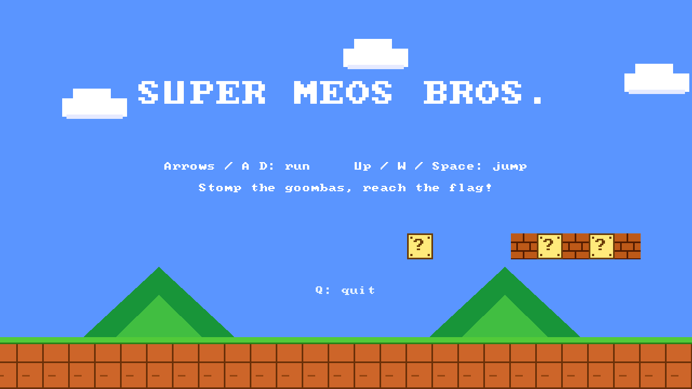
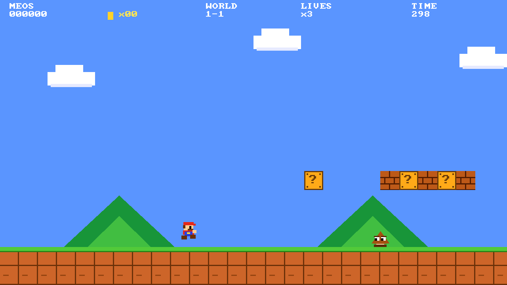
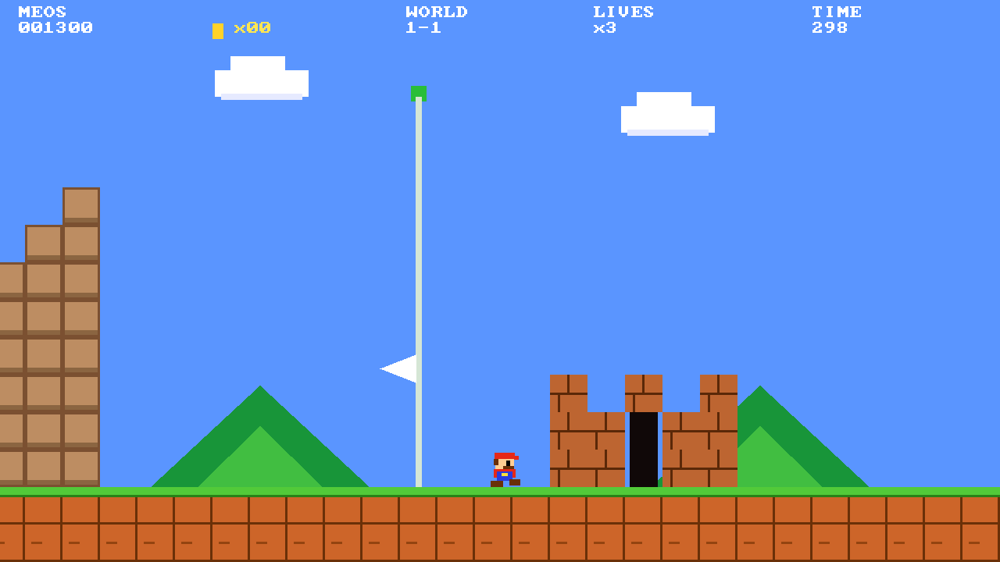
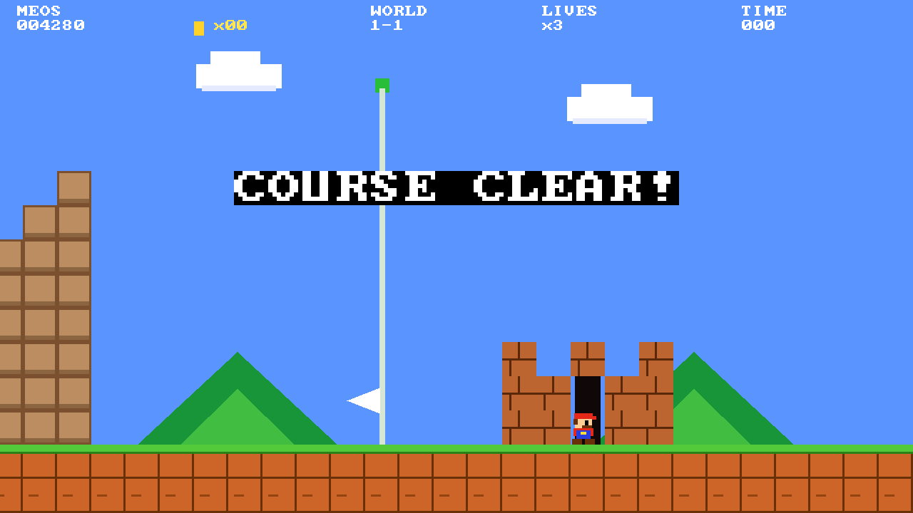

# MeOS-JumpMan — SUPER MEOS BROS.

[MeOS](https://github.com/shi3z/MeOS-app-sdk)（M5Stack Tab5）用の横スクロール・アクションゲームです。
A side-scrolling platformer for MeOS on the M5Stack Tab5, built with the [MeOS App SDK](https://github.com/shi3z/MeOS-app-sdk).



| プレイ中 | ゴール |
|---|---|
|  |  |

*スクリーンショットは SDK のシミュレータ（`meos-sim`）で撮影したものです。実機の画面と同じ 1280×720 です。*

## インストール (QR コード)


1. Tab5 で `install` と入力
2. 上の QR コードをカメラにかざす（`dist/mario_qr.png` を画面に表示するか、印刷）
3. 名前・権限が表示されるので Enter
4. `mario` と入力して起動

QR には `.wasm` の SHA-256 が入っているので、Tab5 はこのファイルと一致するものだけをインストールします。
リンクで入れる場合: `install https://raw.githubusercontent.com/shi3z/MeOS-JumpMan/main/dist/mario.wasm`

必要な権限は `C`（コンソール）と `D`（画面）だけです。サイズは約 24 KB、メモリは 256 KB。

## 遊び方

| キー | 動作 |
|---|---|
| ← → / A D | 走る |
| ↑ / W / Space | ジャンプ |
| Enter | スタート / リスタート |
| Q | 終了 |

- クリボーは上から踏んで倒す（横から当たるとミス）。穴に落ちてもミス。
- `?` ブロックを下から叩くとコイン、レンガは壊せる。コイン 100 枚で残機 +1。
- ポールの高い位置で掴むほどボーナスが大きく、残り時間もスコアに加算されます。
- 残機 3、制限時間 300。

Tab5 のキーボードにはキーを離したイベントがないため、キーを押している間は「約 10 フレーム押され続けた」として扱います。



## ビルド

```sh
git clone https://github.com/shi3z/MeOS-app-sdk
git clone https://github.com/shi3z/MeOS-JumpMan && cd MeOS-JumpMan

# 通常: SDK のビルドスクリプト (clang + lld + llvm が必要)
../MeOS-app-sdk/tools/meos-build mario.c dist/mario.wasm

# clang が無い場合: pip 版 Zig を使う build.sh (SDK を ../meos-sdk-src に置くか SDK=... を指定)
pip install ziglang && SDK=../MeOS-app-sdk ./build.sh

# シミュレータで動作確認 (スクリーンショット付き)
../MeOS-app-sdk/tools/meos-sim mario.c --frames 100 --keys "25:enter,30:right" --shot 80

# QR コードの再生成 (wasm を作り直すとハッシュが変わります)
pip install qrcode pillow
../MeOS-app-sdk/tools/mkqr.py https://raw.githubusercontent.com/shi3z/MeOS-JumpMan/main/dist/mario.wasm dist/mario.wasm -o mario_qr.png
```

## 実装メモ

- `mario.c` 1 ファイル。タイル 48px、レベルは 212×15 タイルで起動時にコードから組み立てます。
- 描画は `fill` と `tri` のみ（1 フレーム約 320 回、30 fps 目標）。画面外にはみ出す `fill` は拒否されるため、`rect()` でクリップしています。
- libc が無いので `memset`/`memcpy` を自前で用意しています（wasm ビルド時のみ）。
- 未確認: 実機（wasm3）での速度。重ければ描画回数を減らしてください。

## English

Install: type `install` on the Tab5 and show `mario_qr.png` to the camera, then type `mario`.
Controls: arrows / A D run, Up / W / Space jump, Enter start, Q quit. Stomp goombas, bump `?` blocks, reach the flag.
Build with `tools/meos-build` from the MeOS App SDK, or `build.sh` (uses `pip install ziglang` instead of clang).

## License

（未設定）"Super Mario" is a trademark of Nintendo; this is an unofficial fan-made clone with original code and graphics.
